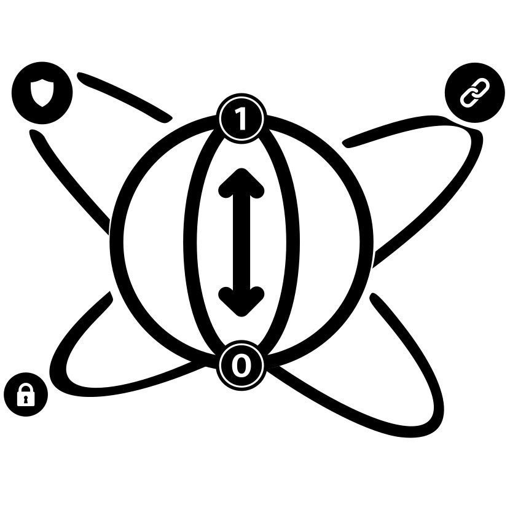

<p align="center">
  
</p>

<h1 align="center">qchain-fabric-performance</h1>

<p align="center">
  <b>What does it cost to make every Hyperledger Fabric identity post-quantum?</b><br/>
  A performance study of QChain's Fabric network with ECDSA identities against ML-DSA-44 identities, as workload, peers and organisations grow, in the design of Nasir et al. (2018): 4 experiments, 1,000 main runs, one machine
</p>

<p align="center">
  
  
  
  
  
  
  
</p>

---

## 📊 Status

| | |
|---|---|
| **Plan** | version 1.1, approved by the project lead on 17 November 2026 ([docs/plan.md](docs/plan.md); earlier versions in [docs/history.md](docs/history.md)) |
| **Literature review** | done: 45 papers, kept outside this repository |
| **Code** | written 16 November, updated for plan 1.1 on 17 November 2026; client unit tests run in the image build, generator self-check and analysis self-test pass |
| **Images** | built natively for arm64 in Colima (17 November 2026); the chaincode image's dependency tree equals the live image's |
| **Measurements** | two smoke sessions passed (16 November); the trial (E0) is next |
| **Test machine** | one MacBook Air M1; every change to it is recorded in [docs/revert-list.md](docs/revert-list.md) before it is made |
| **Next** | the trial (E0), the frozen values (C, E3's reference rate), then the main session, in sittings if needed |

> ⚠️ **Private until publication.** This repository becomes public when the paper is published. Credentials never enter
> any file, and every run folder will pass an automatic privacy scan before it is committed.

---

## Overview

QChain issues academic credentials on a Hyperledger Fabric network whose every identity (organisation CA, peer, orderer, admin, client and node TLS) is signed with **ML-DSA-44**, in a fork of Fabric built by the team (Fabric 3.1.5 line, build tag `pqc`). The same fork builds a classical network with ECDSA P-256 identities. A post-quantum certificate is about 7 times the size of an ECDSA one (5.7 against 0.8 KB) and a signature about 34 times (2,420 against 70 bytes), and every transaction carries several of them, so the question is what that costs in practice.

This repository answers it by repeating the design of Nasir, Qasse, Abu Talib and Bou Nassif (2018, *Security and Communication Networks*): the same three metrics (execution time, latency, throughput), the same stress-test style (all requests at once), and the same three views (more transactions, more peers, more organisations), with the same Fabric fork for both arms. QChain contributes its architecture (the fork, the identity type, the chaincode, the endorsement policy, the orderer, the node configuration); every network setting is the study's own and identical in both arms.

| | Question |
|---|---|
| **RQ1** | How do execution time, latency (average and tails) and throughput change for both arms as the number of transactions grows from 1 to 10,000, for writes and reads? |
| **RQ2** | How do they change as the number of peers grows from 1 to 8? |
| **RQ3** | How do they change as the number of organisations, and so endorsements, grows from 1 to 8? |
| **RQ4** | What else do ML-DSA-44 identities cost: peak memory, CPU, transaction and block size, ledger growth, network traffic, TLS connection setup? |

---

## Architecture

```
 identity {ECDSA, ML-DSA-44}  x  function {issueCredential, getCredential}
          x  T {1, 10, 100, 1,000, 10,000}  x  topology (O organisations, P peers)
                                                 (1,1) (1,2) (1,4) (1,8)
                                                 (2,2) (2,4) (2,8)
                                                 (4,4) (4,8)  (8,8)

 Colima VM (arm64, 4 vCPU, 5 GiB)
 ┌────────────────────────────────────────────────────────────────────────────────┐
 │  Go client ──gRPC/TLS──> peer0.general ──> endorsing peers (MAJORITY of orgs)  │
 │     │                          │                                               │
 │     └── block events <─────────┴── orderer (Raft, 1 node) ── blocks ──> peers  │
 │  one chaincode server and one Fabric CA per organisation                       │
 │  study settings, same in both arms: blocks of 100, no container limits         │
 └────────────────────────────────────────────────────────────────────────────────┘
        │                                         │
        ▼                                         ▼
  host monitor + canary                  results/ (every transaction, checksummed)
        │
        ▼
  analysis/  ──▶  tables T1–T6 · figures F1–F16
```

| Experiment | What it is |
|---|---|
| **E0** | the trial: fixes the burst cap C and E3's reference rate, checks memory and disk, freezes the quality thresholds, projects the main session's time |
| **E1** | the main grid: 2 identities x 2 functions x 5 workloads x 10 topologies x 5 repetitions = 1,000 runs |
| **E2** | connection setup, inside E1's (2,2) networks: a read on a new connection (TLS handshake) against one on an open connection |
| **E3** | offered-load sweep in its own (2,2) networks: writes at 10 to 110 % of the ECDSA saturation, latency against load |

What comes from QChain unchanged, and every difference from its live network, is in [docs/live-differences.md](docs/live-differences.md).

---

## What is measured

| Metric | What it is |
|---|---|
| Execution time, throughput | last confirmation minus first send; successful transactions per second |
| Latency | per transaction, until commit on all peers and at the gateway peer; mean, median, p95, p99, max |
| Stage times | endorse, order, commit, spread to all peers |
| Bytes | per transaction (certificates, signatures, payload) and per block; ledger growth |
| CPU and network | per transaction, per container |
| Memory | peak per container and for the whole network (no container has a memory limit) |
| Failures, blocks | counts by cause; transactions per block and why each block was cut |

The full list (M1 to M12) is in [docs/plan.md](docs/plan.md) §7.

---

## Machines

| | Mac (the only machine) |
|---|---|
| Processor | Apple M1, 4 performance + 4 efficiency cores |
| Memory | 8 GB |
| Runtime | Docker in Colima (Apple Virtualization), arm64, 4 vCPUs, 5 GiB, 60 GiB disk |
| OS | macOS 27.2.1 (automatic updates off during the study) |
| Cooling | cooling pad, used for every run |

> The VM and the Windows laptop of the KPI study are not used here. In the paper the live network's host is described only as *a tested environment*.

---

## Technology stack

| Layer | Technology |
|---|---|
| Fabric | the team's post-quantum fork (`qchain-fabric` `e472b4ea`, `qchain-fabric-ca` `e82caf43`, `qchain-fabric-lib-go` `bd30150`), built natively for arm64 with `-tags pqc` |
| Post-quantum | ML-DSA-44 through Go 1.27 `crypto/mldsa`; ML-KEM-768 through liboqs 0.16.0 |
| Chaincode | `qchaincode` 2.0, Node.js 18, as a service, copied verbatim from `qchain-network` |
| Client | Go 1.27, fabric-gateway v1.7.0, grpc v1.68.0 (the backend's versions) |
| Images | Docker in Colima; base images pinned by digest |
| Launchers | Bash |
| Analysis | Python 3 with numpy, scipy and matplotlib |

---

## Repository structure

```
qchain-fabric-performance/
├── README.md                this file
├── LICENSE
├── docker/                  Dockerfiles: fabric (peer, orderer, CA, tools; arm64, -tags pqc), chaincode, client, analysis
│   └── chaincode-lock/      the live chaincode image's lock file (recorded in step 3)
├── network/
│   ├── live/                qchain-network's files, byte for byte (SHA256SUMS)
│   └── gen/qfp_gen.py       one network from the live files: O organisations, P peers, ECDSA or ML-DSA-44
├── client/                  qfp-client (Go): setup, bursts, per-peer block events, E2, E3, block decoder, canary, tests
├── scripts/
│   ├── run-mac.sh           the Mac launcher: Colima, build, start/resume a session with the KPI's conditions
│   └── qfp.py               the driver: images, networks, runs, Docker statistics, quality, trial report, analysis, publish
├── monitor/monitor-mac.sh   the host monitor (the KPI's)
├── analysis/                run_all.py (tables, figures F2–F16), figstyle.py, selftest.py
├── config/                  thresholds.json, frozen after the trial (written by `qfp.py freeze`)
├── results/                 published sessions (raw/ is local and ignored)
└── docs/                    plan, decisions, history, methodology, data dictionary, provenance, revert list, differences from live
```

---

## Running the study

Everything runs from this folder in Terminal, on the Mac, with VS Code, Teams, Chrome, Edge and OneDrive closed, on the charger, with automatic macOS updates off. For a trial or main session the launcher checks this and refuses to start otherwise; it also pauses macOS background services and switches Wi-Fi off for the session, and undoes both when it ends. Keep the window open until it prints `session <name> finished`.

```bash
# 1. Once: the Colima VM (profile qfp) and the images (the build needs the internet)
scripts/run-mac.sh colima-up
scripts/run-mac.sh build

# 2. The trial (E0), about 1.5 hours; then read its report and freeze the values
scripts/run-mac.sh start trial trial-2
python3 -I scripts/qfp.py trial-report trial-2        # C, E3's reference rate, memory, disk, time
python3 -I scripts/qfp.py freeze --c <C> --saturation <rate> [--split o8p8-mldsa44 ...]

# 3. The main session (E1, E2, E3), in one or more sittings
scripts/run-mac.sh start main main-1
scripts/run-mac.sh status main-1
scripts/run-mac.sh resume main-1                      # after an interruption: finished networks are kept

# 4. After the runs
python3 -I scripts/qfp.py analyse main-1              # tables and figures, inside the analysis image
python3 -I scripts/qfp.py publish main-1              # privacy scan, SHA256SUMS, results/main-1/
```

Checks that need no session: `python3 -I scripts/qfp.py selfcheck` (generator against the live files, verbatim copies, the three Fabric clones, Docker) and `python3 -I scripts/qfp.py analysis-selftest` (the analysis on a synthetic session). `python3 -I scripts/qfp.py down` removes every study container and network volume left by an interrupted session. Raw results stay in the git-ignored `results/raw/<session>/`.

---

## Recent updates

- **17 November 2026: plan 1.1 approved.** QChain contributes its architecture; every network setting is the study's own and identical in both arms (blocks of 100 transactions, no container memory limits). Experiments E0 to E3. Code, images and documents updated and checked (generator self-check, client unit tests, analysis self-test, a real session through `analyse` and `publish`).
- **16 November 2026: images built, smoke sessions passed.** Fabric fork and chaincode built for arm64; the chaincode's dependency tree matches the live image; (1,1) networks of both arms ran writes and reads without a failure.
- **16 November 2026: code written.** Network generator (self-checked against the live files), client, driver, launcher, Dockerfiles, analysis, documentation.
- **16 November 2026: planning done.** Literature review (45 papers), plan approved, repository created.

The whole story, with the reasons for each turn and every earlier version of the plan, is in [docs/history.md](docs/history.md).

---

## Roadmap

- [x] Literature review
- [x] Research plan approved
- [x] Repository and revert list
- [x] Harness and network generator
- [x] Installs and arm64 images
- [ ] Trial (E0)
- [ ] Main run (E1, E2, E3)
- [ ] Analysis, figures and tables
- [ ] Test machine reverted
- [ ] Paper draft
- [ ] Public release with the paper

---

## Documentation

| Document | What it covers |
|---|---|
| [docs/README.md](docs/README.md) | **start here**: reading order and conventions |
| [docs/plan.md](docs/plan.md) | the current research plan: questions, what comes from QChain, experiments, setup, metrics, the trial, statistics, time |
| [docs/methodology.md](docs/methodology.md) | what the code does when it measures |
| [docs/data-dictionary.md](docs/data-dictionary.md) | every file and column a session writes |
| [docs/provenance.md](docs/provenance.md) | every copied file and pinned version |
| [docs/decisions-log.md](docs/decisions-log.md) | the decisions in force and their reasons |
| [docs/history.md](docs/history.md) | how the plan changed: earlier versions, superseded values, failed sessions |
| [docs/live-differences.md](docs/live-differences.md) | what comes from QChain unchanged, and where the study's networks differ from its live network |
| [docs/revert-list.md](docs/revert-list.md) | the Mac's baseline and every change made to it |

---

## Conventions and rules

- **Privacy.** Run folders hold only allow-listed facts. Before a folder enters `results/`, every file is scanned for the machine's host name, user name, home path, IP and MAC addresses and serial numbers.
- **Verbatim copies.** The chaincode and the network files are copied byte for byte from `qchain-network`, except the differences listed in [docs/live-differences.md](docs/live-differences.md). A check script compares them.
- **Revert list.** Every change to the test machine is written in [docs/revert-list.md](docs/revert-list.md) before it is made, and reverted at the end.
- **Frozen thresholds.** The quality thresholds are not changed after the trial (E0).
- **Script names.** A script tied to the Mac ends with `-mac` (`run-mac.sh`, `monitor-mac.sh`); the driver `qfp.py` works on any machine with Docker.
- **Commits.** No co-author lines.

---

## Related repositories

| Repository | What it holds |
|------------|---------------|
| [qchain-network](https://github.com/teamqchain/qchain-network) | the live Hyperledger Fabric network and the chaincode this study copies |
| [qchain-fabric](https://github.com/teamqchain/qchain-fabric) | the post-quantum Fabric fork |
| [qchain-fabric-ca](https://github.com/teamqchain/qchain-fabric-ca) | the post-quantum Fabric CA fork |
| [qchain-fabric-lib-go](https://github.com/teamqchain/qchain-fabric-lib-go) | the post-quantum crypto provider (BCCSP) |
| [qchain-kpi](https://github.com/teamqchain/qchain-kpi) | the algorithm benchmarks whose method this study follows |
| [qchain-backend](https://github.com/teamqchain/qchain-backend) | the Go API whose Fabric client library versions the load generator uses |
| [qchain-docs](https://github.com/teamqchain/qchain-docs) | reports and the setup guide |
| [qchain-fabric-performance](https://github.com/teamqchain/qchain-fabric-performance) | this repository |

Some of these repositories are private.

---

## Team

A University of Sharjah capstone project, supervised by **Dr. Manar Abu Talib** and **Dr. Sohail Abbas**.

| Member | Role |
|--------|------|
| Mohammed Bin Ali Maqqavi ([@M0hd-Maqqavi](https://github.com/M0hd-Maqqavi)) | Project Manager |
| Mohammed Abdul Haris ([@mohammed-ah-14](https://github.com/mohammed-ah-14)) | Technical Lead |
| Mohammed Nihal ([@nihvp](https://github.com/nihvp)) | Quality Assurance Lead |
| Mohammed Obeid ([@MohammedObeid88](https://github.com/MohammedObeid88)) | Blockchain Specialist |

---

## License

**Proprietary — all rights reserved.** © 2026 QChain. This source code and its data are proprietary and confidential;
unauthorized copying, modification, distribution, or use is prohibited without prior written permission.
See [LICENSE](LICENSE).

---

## Disclaimer

This is an academic research project. The measurements will describe one machine under controlled conditions and the team's Fabric fork of 30 October 2026; they are not a certification of any algorithm or product. The live network's host is a tested environment only. Both networks of the study are built for it and differ from QChain's live network in the ways listed in [docs/live-differences.md](docs/live-differences.md).
